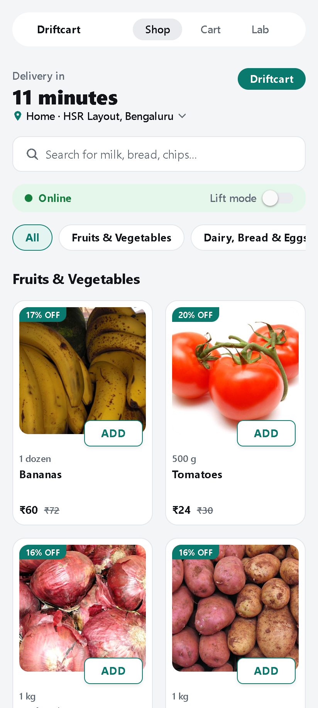
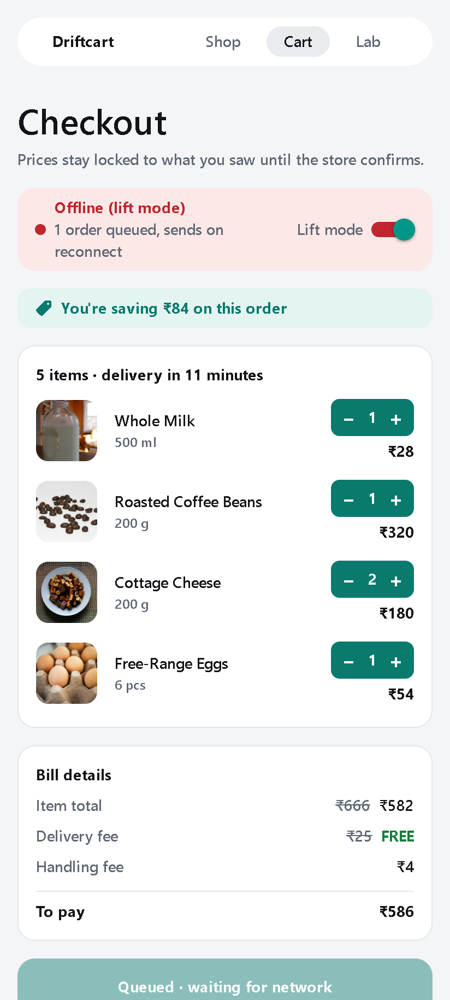
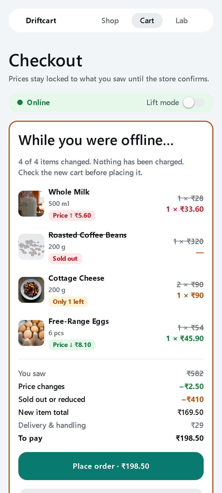
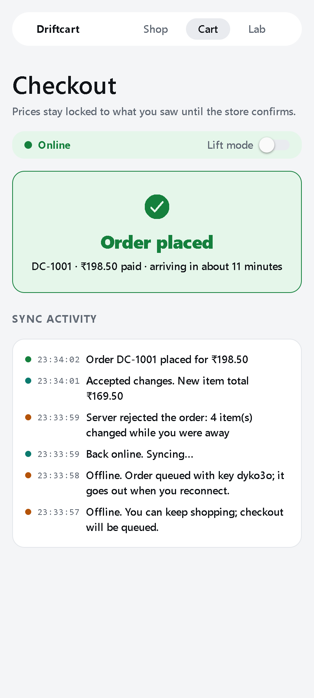
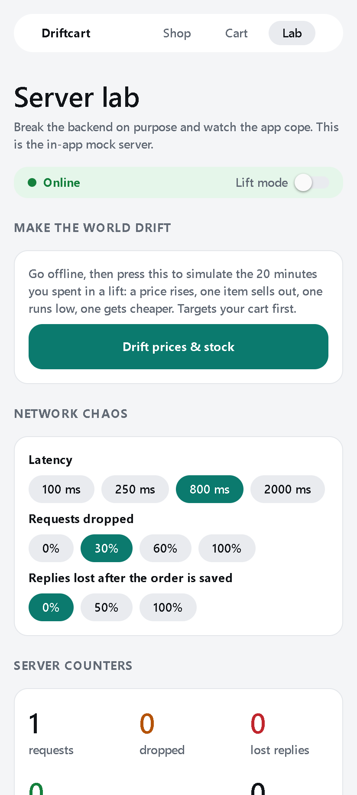

# Driftcart

**A quick-commerce cart that keeps working when your network doesn't, and never charges you a price you didn't see.**

React Native · Expo SDK 58 · TypeScript (strict) · Zustand · Expo Router · Jest + React Native Testing Library · GitHub Actions

## Try it

| 📱 Android app | 🌐 Web (any phone or laptop) |
|---|---|
| <br>**[Download the APK](https://expo.dev/artifacts/eas/QQuUywqx3d038Qeewh1eKWqg0QYqFSQrstYyyeFx3YI.apk)**<br>Scan with your phone camera, download, then tap *Install* (allow "install from this source" once). | **[driftcart-five.vercel.app](https://driftcart-five.vercel.app)**<br>Nothing to install. Same app, built from the same code. |

The APK is a standalone release build (Expo EAS, `preview` profile). Android only; iPhone users can use the web link.

## Screenshots

| Shop | Offline, order queued | Back online: what changed |
|---|---|---|
|  |  |  |

| Placed, exactly once | Server lab (chaos controls) |
|---|---|
|  |  |

## The problem

You add milk, coffee and cottage cheese, then walk into a lift and lose signal. You press "Place order" anyway. While you're offline, milk goes up by ₹5.60, the coffee sells out and only one cottage cheese is left.

Most cart demos either fail silently or re-price behind your back. Driftcart does three things instead:

1. **Queues the checkout offline** and sends it automatically when the network comes back.
2. **Lets the server reject drift.** The client sends the prices the shopper *saw*. Any mismatch, up or down, is a conflict and never a silent re-price.
3. **Shows a red/green review** ("While you were offline…") with every change explained, so the shopper confirms the new total before paying.

It also handles the nastier case where **the order was saved but the reply was lost**. Every checkout intent carries one idempotency key. That key survives retries, offline queues and app restarts, so a retry gets the original order back instead of creating a duplicate. The Lab tab lets you cause that failure on purpose and watch the "duplicates prevented" counter go up.

## What's novel here

This isn't a tutorial cart. The interesting parts are the sync and consistency engineering, not the screens:

- **Price-you-saw contract**: cart lines store `pricePaiseSeen`, and the server compares against it ([shop-core.ts](src/server/shop-core.ts)).
- **Pure reconciliation**: `reconcile(cart, catalog)` is a deterministic function that produces the diff, the rebuilt cart and the totals. The UI and the tests both run on it ([reconcile.ts](src/sync/reconcile.ts)).
- **Idempotent checkout** with exponential backoff and full jitter. Offline errors are *queued*, not retried ([retry.ts](src/sync/retry.ts), [cart-store.ts](src/store/cart-store.ts)).
- **Cart lock when the outcome is unknown**: once a request with the key *might* have reached the server, the cart can't be edited. Editing would let a different cart reuse a key that may already be committed.
- **Crash-safe**: an app killed mid-request rehydrates as "queued" with the same key.
- **A chaos lab built into the app**: latency, dropped requests, lost replies, price and stock drift, and live server counters ([mock-server.ts](src/server/mock-server.ts)).

## Run it

```bash
npm install
npm start          # scan the QR with Expo Go on Android, or press w for web
npm run check      # typecheck + lint + 28 tests
```

**60-second demo script**

1. Shop: add milk, coffee beans, 2× cottage cheese and eggs. Open Cart.
2. Flip **Lift mode** on and press **Queue order**. The status bar turns red with "1 order queued".
3. Lab: press **Drift prices & stock**.
4. Flip Lift mode off. The order auto-sends, the server rejects it, and the **"While you were offline…"** review appears.
5. Press **Place order**. Done, once.
6. Bonus: in Lab, set *Replies lost* to 100% and order again. The sync log shows a retry with the same key, and **duplicates prevented** goes to 1.

## Catalog and design

25 products across 5 categories with Bengaluru-style 2026 prices, MRP and discounts. Product photos are Creative Commons images bundled with the app, so the store still renders offline (credits: [assets/products/CREDITS.md](assets/products/CREDITS.md)). Product names are generic and the brand palette is my own; nothing is copied from a real quick-commerce app.

The bill (item total, delivery fee, free-delivery threshold, handling fee) comes from one pure function, `billFor`, used by both the cart screen and the server, so **the number shown is the number charged**.

## Architecture

```
src/
  domain/      types (integer paise everywhere), money, bill, seed catalog, bundled product images
  sync/        reconcile (pure), retry/backoff, offline-gated API, error types
  server/      shop-core (pure, idempotent order logic) + MockShopServer (chaos knobs)
  store/       Zustand vanilla store (testable without React) + persistence + hooks
  components/  ProductCard, ProductImage, DriftReview, ConnectionBar, QtyStepper, SyncLog, UI primitives
  app/         Expo Router tabs: Shop, Cart, Lab
```

The store depends only on a `ShopApi` interface, so swapping the in-app mock for a real HTTP backend is a one-line change in [store/app.ts](src/store/app.ts).

## Testing

28 tests, all deterministic (injected clock, randomness and sleep, so there's no real waiting):

- `reconcile`: price up/down, stock caps, sold out, delisted, combined drift, no input mutation
- `shop-core`: commit, idempotent replay, conflict rules, conflicts not cached, validation
- `retry`: backoff curve, jitter, give-up, no retry when offline
- `cart-store`: offline queue → reconnect, drift → review → accept, **lost reply → no duplicate**, exhausted retries → queued with the same key and the cart locked
- `billFor`: delivery and handling fees, free-delivery threshold
- `<DriftReview />` with React Native Testing Library

CI (GitHub Actions) runs typecheck, lint and tests, then bundles for web and Android. A step-by-step guide to how it works is in [docs/LEARN-GITHUB-ACTIONS.md](docs/LEARN-GITHUB-ACTIONS.md).

## Trade-offs and limitations

- **The backend is in-process.** The mock server runs inside the app, so the demo works with zero infrastructure and zero cost. It resets on reload. The order logic is a pure module, so it can be moved behind an HTTP API without changes.
- **Conflicts aren't cached by idempotency key, only successes are.** After a conflict the shopper sees a new cart, and that's a new intent with a new key. Stripe caches every response. I chose this because it keeps the "fixed cart" path simple.
- **Last-write-wins on the client cart.** There's no multi-device cart merge (that would need CRDTs or server-side carts).
- **No real payments.** Placing an order is where a payment intent would go, and it would reuse the same idempotency key.

## Deploy (free)

- **Web demo**: import the repo into Vercel (Hobby). `vercel.json` already sets the build command, output folder and SPA rewrites.
- **Android APK**: `npm run build:apk` builds in Expo's cloud (free tier) and gives you a download link anyone can install.

No API keys, no LLM, no paid services.

## Roadmap

- A small **Kotlin native module** (Expo Modules API) that reads connection type and metered status, so the app can delay big syncs on mobile data
- A hosted API (shop-core behind a serverless function + Postgres) to replace the in-app mock
- A Maestro end-to-end flow on Android
